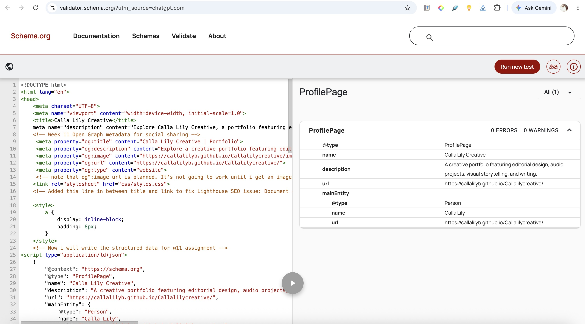
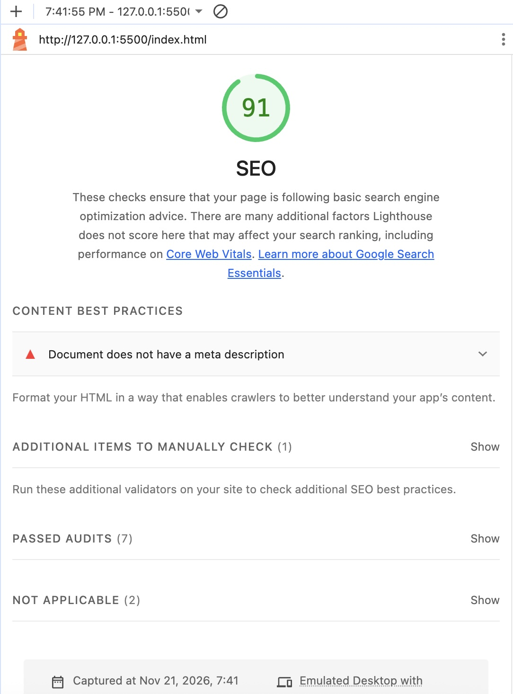
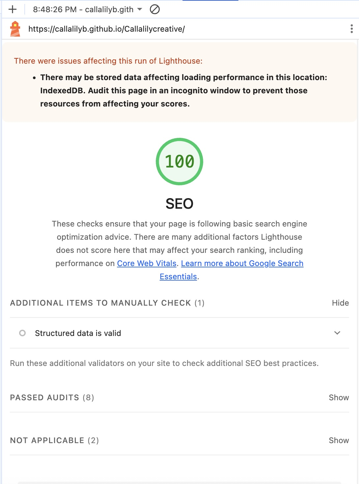

# Callalilycreative
Beginning with Week 5 assignment and building on this weekly

Calla Lily Creative: A personal creative portfolio showcasing visual, audio, and written work. 

Deliverables for mtm1511 Week 5 assignment:
site map
mobile homepage wireframe
desktop homepage wireframe
semantic html skeleton for homepage

Site structure:
Home
Visual
Audio
Writing
About
Contact
-- each of these will be accessible through the main nav

SITE MAP for Week 5 Assignment:

Calla Lily Creative
|
|----home
|
|--------Visual (visual.html)
--------Audio (audio.html)
--------Writing (writing.html)
--------About (about.html)
--------Contact (contact.html)

I hope this makes sense written like that. 

To view the homepage HTML skeleton, this is the link [https://callalilyb.github.io/Callalilycreative/] 

Mtm1511 Week 6 Assignment:
Skip link created and tested: yes
Contrast ratios: yes
    there is no css here, so I ran the contrast check on the standard browser colours, regular text, unvisited links, and visited links. Each passes contrast ratio check. This assumes Chrome is using standard default colours. 
Lighthouse accessibility audit: first score 94/100
    "Touch targets do not have sufficient size or spacing."
    This requires a bit of CSS to add padding
    style tag added in 'head' with padding. Used ChatGPT to reccommend and it suggested an inline-block as well. 
Lighthouse audit #2: 100/100!

=====Activity Log=====

 /* nov. 3rd i've added card image for project 01. 02 and 03 not done yet. */

 /* Nov. 4th. I am working on adding more pages and styling them.  */

Nov. 5. Today I want to make sure that the styling between all the pagees is consistent. Working in css.

updated css classes in visual.html so that all 3 portfolio pages are consistent.

Adding a field in the contact form for phone number (optional)

Also styling the 'creative services' table in contact page.

Nov. 6-7 Final html, css, Lighthouse, responsive checks

Site width at 375: looks good on all pages! no awkward spacing or text-wrap.

No warnings, no errors for contact.html on W3 check
no warnings, no errors for tyles.css
about.html: good
visual.html: good
audio.html: fixed typo, then passed
writing.html: good
index.html: good

Lighthouse test: 100 score! 

Nov. 16 Week 10 SEO Assignment

updated head section on audio and visual page to include meta descriptions

html checker
audio.html: no errors no warnings
visual.html: no errors no warnings

Week 10 Accessible keyboard focus
Give all interactive elements a visible focus indicator

skip-link: focus-visible works in chrome!

Lighthouse test: accessibility, Desktop - 100 score!

axe report: 0 total issues yay!

Nov. 21 Working on Week 11 Assignment

Lighthouse SEO test score: 91/100
Flagged issue: Document does not have a meta description. 
Added meta tag in title of index.html to fix this. 

Open Graph requirement
og:title identifies Portfolio
og:description summarizes the content in Portfolio
og:image displays a preview image
og:url identifies published homepage
og:type classifies this page as a website

Note that og":image url is planned. It's not going to work until i get an image in here and name it og-preview.jpg.
- preview image has been created in Photo Shop.

In the Head of my index.html, I wrote the JSON-LD structured data using the Schema.org ProfilePage type. It introduces me, my profile, my creative work.

Schema Markup Validator used to copy paste index.html file and run test. 
0 warnings, 0 errors!

Adding 2 contextual internal links: one for magazine cover and the other for audio doc.
These work because they both appear in the main page content. they also both use descriptive text rather than generic phrases like "click here"

Checking for orphan pages. The two context links in my cards on the homepage are working well, linking to the correct pages. All links in the navigation bar working as well.

Second lighthouse check in dev tools after working on Week 11 SEO requirements
SEO and Desktop selected. score: 100/100
(compared to 91/100 when I started)

##SCREENSHOTS FOR WEEK 11 ASSIGNMENT

 

I used chatgpt to figure out how to put these screenshots here in my Readme file. I hope it works, but if not, the required screenshots are in the images>screenshots folder of my code. 

<!-- Nov. 22 working on Week 11 CSS -->

replacing repeating properties with custom variable properties
0.75rem is now var(--space-xs)
1rem is now var(--space-sm)
1.5rem is now var(--space-md)
2rem is now var(--space-lg)
3rem is now var(--space-xl)

 ==Nov. 23 activity for week 11 assignment==

 Creating a component variant using CSS variable overrides:
 update .featured article rule
 create highlighted card variant, then apply in html
 check the results

 chatgpt used here to create a sort of check list for this step

